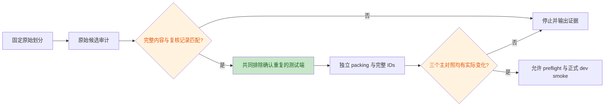
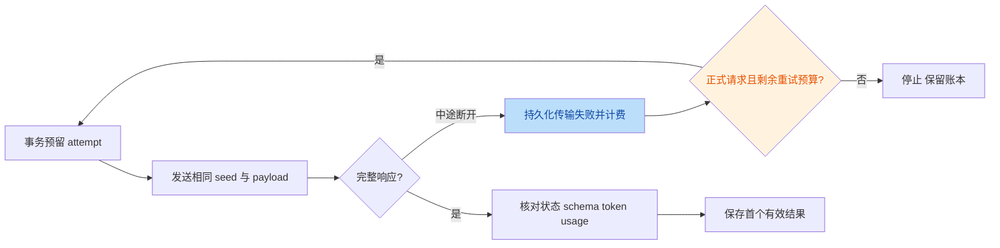

# v0.2.0 评审范围与待交叉验证问题

基线：`b7990d1`；代码范围：E2 相对 `e09fe84` 新增的执行器、适配器和测试。
科研范围：V4 加 `docs/component_replay_protocol_v5.md` 的 V5-RC1 修订。
用户要求综合评估、版本化 README、推送，并给出服务器下一步。
V5 研究/统计/工程三轮通过前不实现新路径。

## 意图

用同一历史的固定规则/经历交叉组合做有限预算机制 discovery，
严格保留真实输入、上下文、请求预算和先 dev 后 test。
本轮修订要把已核实的公共数据重复处理做成可追溯资格判定，
并阻止明确无实际主对照的生成，保持原统计范围和阈值。

## 代码候选问题（两名复核者均需验证全部问题）

| ID | 初判 | 问题 | 最小代码位置 | 拟修复 |
|---|---|---|---|---|
| C1 | P2 | 响应宣称 Content-Length=1000、实际只传11字节后断开时，`response.read()` 抛出 `http.client.IncompleteRead`，不属于现有 except 元组。执行器退出而非按承诺落盘传输错误并在剩余预算内重试。预留 attempt 没丢失，不应夸大为免费重试或错误评分。 | `src/memgate/experiments/ledger.py:27-33`；调用处 `:209-212` | 记录不完整传输及可用部分证据，按原 seed/payload/计费规则恢复，保留 probe 禁止重试和完整损坏响应拒绝。 |
| C2 | P2（资源/验收） | 旧规则首条过长被合法 packing 全删时，ON 可与 ZE 全部相同；新规则不为空且经历发生变化时，当前 joint-change 检查仍通过。该检查不能保证三个预定主对照均包含实际输入干预，会在 C3 无可识别干预时继续支付整批生成成本。这不是 Hoeffding 公式错误，也不声称当前服务器已触发。 | `src/memgate/experiments/study.py:148-154` | 在固定 test 上分别计算 ON/OO、ON/NN、ON/ZE 完整 IDs 的差异数；任一为0，报无效主对照并在生成前停止，不换题或快照。 |

复现已执行：

- C1：本地临时 HTTP 服务返回11字节后断开，异常为
  `http.client.IncompleteRead: IncompleteRead(11 bytes read, 989 more expected)`。
- C2：真实官方纯 builder + 现有 TinyTokenizer，旧规则为一条2000字符规则，
  新规则及两个经历版本使用现有测试夹具：
  `eligible=True, old_rules='(empty)', passes_current_joint_change_gate=True, ON_identical_to_ZE=True`。
- 未改代码前全量测试：`46 passed in 40.75s`；上述故障此前不在测试断言中。

## 不作为程序 bug 的问题

- V4 对所有近重复候选停止是有意的协议保护。缺少人工复核消费入口是
  V5 要补的流程能力；不能把 require 直接删除。
- 96/94题的保守 CI 半宽很大是真实的设计局限，不是统计公式算错。
- E0/E1 的旧问题仍在旧审查中。当前 E2 不走在线 Runner/restore，
  本轮不改官方子模块或假装修复全部历史实验。

## 本轮独立数据复核

公开源：
`https://hf-mirror.com/datasets/TIGER-Lab/MMLU-Pro/resolve/main/data/test-00000-of-00001.parquet`，
2026-10-24 下载，Engineering=969。
只将 qid/题干/选项投影给复核者，没有提供答案或 CoT。

- 有序公共投影 SHA256：`478bd4297ac233c672dfc934cb1ab2c1c01c1d3740005c10222c270ae6852e20`
- 原始 parquet SHA256：`0e24a191921c2f453518a537a8b2117bd137e7714d4ef1565e9ba06c1ecb9ad8`
- 现有算法重新计算原始候选审计 SHA256：
  `fa0a1f1d11e97a702a3a78620d88a261b7778fb4e6cc350211560f41a797d7fe`
- 候选仍为3对；题干相似度依次0.9458128078817734、0.925、0.9921875。
- 原题核对为两对同题、一对公式不同；具体判定见 V5-RC1。
- 服务器原始日志/账本未取到；SSH 超时。公开内容核对不能冒充服务器验收，
  新执行器必须在服务器校验同一公共投影、全部候选、源完整性和零尝试迁移。

## 审查流程图

