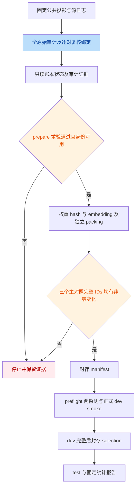
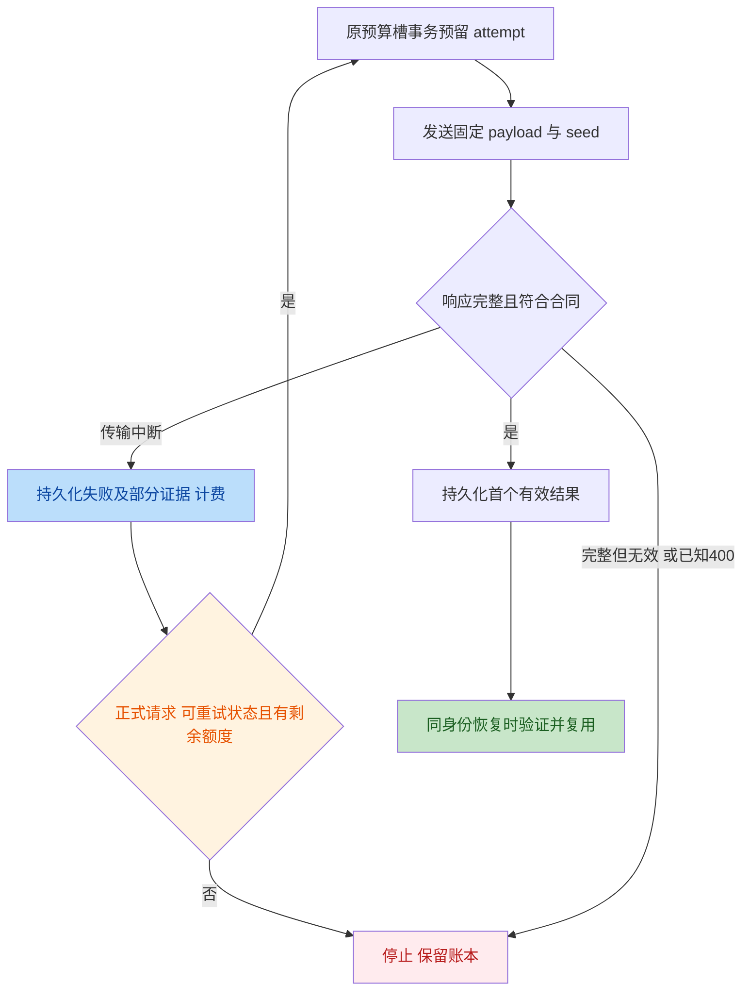

# 2026-10-24 R3：V5 工程与执行可行性独立评审

## 结论

- **C1、C2 均存在，均为 P2 / major，非误报。** 前者是自动恢复与错误证据缺口，后者是生成前主对照有效性检查缺口；不升级为预算失账、错误统计公式或已发生的服务器事故。
- **R3 = PASS_FOR_IMPLEMENTATION_IF_R2_PASS**：V4 加 V5-RC1 的工程合同可实现，无须为可编码性改变科研设计。收尾时已读取本次 [R2:39-49](file:///Users/bytedance/research_26/research_2026_cc/docs/reviews/2026-10-24_r2_statistics.md#L39-L49) 的 `PASS_FOR_FROZEN_PILOT`，且核对其 V5 文件 hash 一致，因此此设计前置已满足；不是用 10 月 20 日的 V4 R2 PASS 代替。通过仅允许编码，不授权生成。
- **当前基线按 V5 执行 = FAIL（未满足运行准入）**：C1/C2 未修，新审计/复核路径尚未实现，服务器源、账本、真实 tokenizer/上下文和 smoke 均未独立验收。软件版本升级或本报告不能解除这些阻断。
- 最小实施范围是本文列出的数据审计入口、身份绑定与共同排除、C1/C2 修复、回归测试、版本和交付文档。任何验收失败均停止；不得通过换题、换快照、删除账本、扩大上下文或追加预算取得通过。

## 两项交叉核实

以下 JSON 的 `severity=major` 对应本轮候选的 P2，不表示 critical：

```json
[
  {
    "issue_id": "C1",
    "exists": true,
    "severity": "major",
    "reasoning": "P2。ledger.py:27-33 的 response.read() 可抛出 http.client.IncompleteRead，现有异常元组及 study.py:473 的外层处理均不捕获它。独立纯内存 HTTPResponse 复现 Content-Length=1000、实收11字节，得到 IncompleteRead(11 bytes read, 989 more expected)。complete 在 ledger.py:217-219 先 reserve 再请求，因此已有1次计费 attempt、raw为空、result为0；自动落盘传输错误并重试的承诺失效。再次调用同一请求会消耗1次 retry，总attempt变为2，payload和seed不变；不是免费重试、失账或错误评分。"
  },
  {
    "issue_id": "C2",
    "exists": true,
    "severity": "major",
    "reasoning": "P2（资源/验收）。study.py:148-154 只要求至少一题 packed_rules 与 packed_experiences 共同变化。用真实官方纯 builder、TinyTokenizer 和固定向量独立验证：旧规则首条2000字符被合法 packing 全删，新规则保留2条，经历变化，eligible和joint-change均为true；但ON与ZE完整输入IDs相同，ON与OO/NN不同。旧规则打包与题目无关，此条件可令全部合格test的ON/ZE无输入干预，仍进入生成计划。当前不同臂仍独立生成，不是Hoeffding公式错误，也不证明真实服务器已退化；应在生成前逐一检查三个主对照的完整IDs差异数，任一为0就停止。"
  }
]
```

| 编号 | 问题 | 最小建议 | 源码位置 |
|---|---|---|---|
| C1 | 不完整 HTTP 响应绕过传输失败落盘和自动重试 | 显式保存中断类型、部分字节证据及可知的 HTTP 状态；正式请求沿用原 payload/seed 和预算；probe 不重试 | [ledger.py:27-33](file:///Users/bytedance/research_26/research_2026_cc/src/memgate/experiments/ledger.py#L27-L33) |
| C2 | joint-change 不能保证 ON/ZE 存在实际干预 | 在最终合格 test 上分别计数 ON/OO、ON/NN、ON/ZE 的完整 IDs 不同题数；任一为零，生成前停止 | [study.py:148-154](file:///Users/bytedance/research_26/research_2026_cc/src/memgate/experiments/study.py#L148-L154) |

候选文档 C1 的辅助调用位置 `209-212` 不是实际派发位置；基线的 reserve/request/save_raw 位于
[ledger.py:217-219](file:///Users/bytedance/research_26/research_2026_cc/src/memgate/experiments/ledger.py#L217-L219)。
此行号修正不影响问题成立。

反证检查：

- C1：预留事务和剩余重试上限确实存在，`raw is None` 会走保守恢复；因此删除“免费重试/无法恢复”的扩大解释，只保留自动恢复中断及部分错误证据未保存。
- C2：`pack_rules` 只保留完整前缀，长首条导致空块是合法设计，不应修改 packing 来隐藏问题；七臂因子不变性检查也不能证明所有必要对照均非退化。相同输入的两次独立回答不必逐字相同，不能据此共享回答或将统计系数消零。

## 范围与方法

基线及本地 HEAD：`b7990d15f6a1609646bf8a9792e230bd890441a1`。
读了候选全集 C1/C2、V4、待审 V5-RC1、执行器及其 source/prompts/official/inference/common、
相关测试、真实官方 builder/检索定义、服务器桥接和现有 README/执行文档。
检查了 E2 相对 `e09fe84` 的引入范围；开始评审时本地受版本控制文件与基线无差异。
两项独立复现和第二遍源码复核完成后，工作区出现其他会话新增的 R2、实现清单及 README 修改；
仅补读这些交付材料，不覆盖它们，也不把它们的工作记为本评审所做。

本次审阅的协议/候选文件 SHA256 与 R2 一致：

```text
V4: f858562d595bb1e96d6f9b5f60538de43bb423da49e83d5883a4989e5137d0d8
V5-RC1: 51282a35aea3acc7f62624729cf290d107d4d2fec052a129bf23ebf7749cc919
candidates: 56a8021fdcf9e677c659488c17477bdd7140b8dd9838ba97c0f2cbd4bda51e31
```

意图：保留固定历史、独立双组件 packing、固定 ON 主对照及有限预算 discovery，
把已复核的公共内容判定转为可追溯的运行前资格检查，并停止没有实际必要对照的生成。

采用 TRAE-code-review。此会话无子代理派发工具，按其 fallback 对全部两项进行了独立读源、
离线复现和第二遍反证复核；这是交叉验证中的一个独立评审，不冒称获得两名子代理的 2/2 共识。
因用户明确只评审，不请求修复选择，也不修改实现、协议、配置或官方子模块。

## 公共数据复核

本次使用 `pyarrow.parquet.read_table(..., columns=["question_id", "category", "question", "options"])`
读取 `.cache/e2_review_public/test.parquet`。未调用会读取答案的 `load_public`，
未读取 `answer`、`answer_index`、CoT 或任何新模型输出。
Engineering 为 969 题，边界为 193/581，按现有算法得到原 dev64/test96。

hash 口径：使用 `common.digest` 的 canonical JSON，即 UTF-8、对象键排序、
紧凑分隔符、`ensure_ascii=False`、禁止 NaN。公共列表保留源行顺序，单题对象是
`{qid: 字符串, question: 原题干, options: 原顺序选项}`，不使用相似度规范化文本代替原文。

| 独立重算项 | SHA256 |
|---|---|
| 全部 969 题有序公共投影 | `478bd4297ac233c672dfc934cb1ab2c1c01c1d3740005c10222c270ae6852e20` |
| 完整原始候选审计对象 | `fa0a1f1d11e97a702a3a78620d88a261b7778fb4e6cc350211560f41a797d7fe` |

后者是未作排除的完整审计对象 hash，不是仅三对 qid 的 hash，也不是外层 sealed 文件的字节 hash。
现有算法作了 99104 次 prefix/dev/test 跨边界比较，候选三对，全部非 exact、
`status=unresolved`、`qualified=false`；与候选文档相符。未另行读取整个 parquet 重算文件字节 hash。

| prefix / test | prefix 单题公共内容 hash | test 单题公共内容 hash |
|---|---|---|
| 11528 / 12215 | `ad27e48e4333ef3f125dfe328d6ae1fe8424ce5d154755014da8afc2aed54b5a` | `3a412aec8a9c7dbaee757f0c5d14c247d1d424aca8b43fd3116d2c9ac5df70ed` |
| 11568 / 11872 | `1b77d967cd243ccaf1a2f1e80584715d566b5e5fc15c69e633689a9ee7eb64b3` | `b8d17eb96cd12d880a272abcca22f51445b1455fd141a618318ec0cd49badf6f` |
| 11804 / 11932 | `ebad516149f261284be3af6d8a143bf45f9402e07d477313bc38e1879528852e` | `3883435ab5938164a15306b93d53c2aede3e27c7f67fd7adac2f73a4c1def21b` |

口径交叉说明：R2 的六端 hash 使用 `{question, options}`，本表使用 `{qid, question, options}`。
本次补充用允许的四列重算了 R2 的六个 content-only hash，全部一致；两表数值不同不是数据冲突。
发布复核记录必须选择一种明确、版本化的 schema，全程一致，并另绑定阶段/qid；
不能把一表的 hash 交给另一口径的验证器，也不能为匹配 hash 排序选项或改正文。

独立阅读完整题干和选项后的判定：

- 11528/12215：1000 Mc/sec 与 1 GHz 等价，其余入射、场强、铜板及目标量一致；选项表示/内容变化不改变同题判定。共同排除 test 12215。
- 11568/11872：`1/[s(s^2+1)]` 与 `1/(s-1)^2` 是不同表达式，不能因模板相似视为同题。保留 test 11872。
- 11804/11932：directivity=50、波长 4m、目标为最大有效孔径完全相同；不能因选项变化判 distinct。共同排除 test 11932。

这只证明当前字符筛查产生的三对得到了完整复核，**不证明全库语义去重完备**，
也不证明源记忆实际检索过这些题、发生了答案利用或效应偏差。
原始源与账本仅在服务器，本次未取得，未把公开文件核对当作服务器数据验收。

## 实施合同核对

### 1. 审计必须早于模型操作

[V5:100-106](file:///Users/bytedance/research_26/research_2026_cc/docs/component_replay_protocol_v5.md#L100-L106)
可实施，但不能只在现有 `prepare` 内加一个选项：
[study.py:445-450](file:///Users/bytedance/research_26/research_2026_cc/src/memgate/experiments/study.py#L445-L450)
会先完整 fingerprint，
[study.py:46-51](file:///Users/bytedance/research_26/research_2026_cc/src/memgate/experiments/study.py#L46-L51)
已经遍历模型和 embedding 文件。

最小顺序为：公共列投影与源审计、完整原始候选审计、复核绑定、账本只读检查；
`audit-data` 至此返回单一证据路径。`prepare` 重新执行同一检查并核对输入一致后，
才计算权重/embedding hash、加载 tokenizer/CPU embedding、打包。不存在模型目录或不可连接的
base_url 不应妨碍独立数据审计。既有 manifest 也不能绕过新绑定的复核。

不能直接复用 [source.py:16-35](file:///Users/bytedance/research_26/research_2026_cc/src/memgate/experiments/source.py#L16-L35)
作为 public-only 审计入口：它目前读取整表和 gold。应拆出明确列投影，评分材料仍独立封存，
不进入资格判定、query、检索、prompt 或 selector。
完整源验证只比较全流公开字段和完整性，组件构造器只得到前 581 条；
源前缀里的合法历史 trajectory/insights 原文不得清理、重写或移除重复题。

### 2. 绑定与资格必须形成同一条证据链

[V5:33-57](file:///Users/bytedance/research_26/research_2026_cc/docs/component_replay_protocol_v5.md#L33-L57)
已要求全公共投影、全原始审计、三对两端阶段/qid/内容 hash 和完整复核。
实现时应冻结 schema/version 与 canonical hash 口径，检查候选集合及唯一性，而不是只检查数量为 3。
漏项、多项、重复、未决、phase/qid 交换、内容/判定不符均拒绝；新出现的 prefix/dev 或 dev/test
冲突不套用 test 例外。配置中的判定必须符合本次冻结的 duplicate/distinct 映射。

先在原始划分上审计，再产生独立 V5 数据资格产物；不能先排除再用“无候选”替换旧审计。
旧 `duplicate_audit.json` 和 `qualified=false` 原样留档。新资格产物保留原候选及复核摘要，
不是把 raw audit 的标志翻成 true。

manifest/fingerprint 必须绑定 V4 基础合同、V5 修订、复核文件内容、源/公共数据、
原 split、数据排除、最终共同资格和调度。当前
[study.py:33-40](file:///Users/bytedance/research_26/research_2026_cc/src/memgate/experiments/study.py#L33-L40)
只纳入 V4；不能仅把 CLI 名称改成 V5。
不可将 audit-data 的运行时间、账本阶段/次数等可变状态放进输入 identity，否则正常续跑会自我拒绝。
应区分稳定的数据资格证据和可更新的执行状态摘要。

全臂只排除 test 12215/11932，dev 与 prefix 不变，11872 保留，不补位。
数据排除后 test=94，之后仍可能有上下文排除，最终 n 至多94。检索/打包/请求只对数据合格题执行。
重复排除没有 `questions/` 文件也必须进入 manifest 和最终报告；现有
[study.py:393-396](file:///Users/bytedance/research_26/research_2026_cc/src/memgate/experiments/study.py#L393-L396)
只从已打包 question 读取排除，不能单靠它报告 V5 的数据排除。

### 3. 只读检查、零尝试迁移与恢复

保持 `runs/.e2-ledgers/component-v4.sqlite` 同一个预算槽，不另建 `component-v5.sqlite`。
现有
[ledger.py:104-114](file:///Users/bytedance/research_26/research_2026_cc/src/memgate/experiments/ledger.py#L104-L114)
已有不同 identity 只在 attempts/results 都为空时重绑定的基础，可复用这一限制。

`audit-data` 不得实例化当前 Ledger：其构造函数会建目录/锁/表、设置 WAL 并可能删除旧 meta。
应只读、一致地检查既有数据库及有效 WAL 状态，报告身份、阶段、logical/probe/retry/总 attempts
和 results 数，不输出回答/score；数据库缺失、损坏、不可读或迁移来源不明不能报告“已核实零尝试”。
不能以忽略 WAL 的读取方式得出零计数。

实际迁移必须在持有原预算槽互斥锁时重新确认零 attempts 且零 results，不能仅信之前的审计快照。
任一 probe、超时/未知派发、raw 未落盘的 reservation 都算 attempt；即使正式行是零也拒绝 V4→V5。
保留旧内容寻址产物和旧身份溯源，不复用旧 manifest；不要因只读检查失败而清库。

V5 同身份有 attempts 时应允许续缺失行，而非把“零 attempts”错误地施加到所有 audit-data/prepare。
阶段结果、raw、payload/seed、服务证据、selection 和输入身份继续核对。
复核文件/代码/协议/数据变化后，有任何 attempt 就拒绝迁移/续用；无新增预算。
没有服务器账本证据之前，这一迁移前提仍是未验收，不是已满足。

### 4. C1 修复不能打开错误恢复通道

应区分“传输不完整”与“完整但无效响应”，保存部分字节的无损表示或可验证摘要及长度、
预期剩余字节、异常类别和可知 HTTP 状态。部分内容即使恰能解析为 JSON，也不能当成完整成功回答，
不得计分为 0 或从中挑选有效答案。

`HTTPError` 的 `exc.read()` 自身也可中断；仅向后面的同级 except 元组加入异常并不能覆盖该分支。
已收到 400/上下文拒绝时仍必须停止，不能丢掉 HTTP 状态统一包装成 `status=None` 后重试。
完整但损坏的 UTF-8/JSON/schema、token usage 不符应保存不可重试证据并停止，重启也不能洗成未知派发。
不要广捕获解析/评分错误再当网络失败。

正式逻辑请求依同 payload/seed 在每请求最多3 attempts、全局44 retries和总上限内重试；
probe 仍只发一次。已落盘有效 raw 先恢复评分，已接受 result 验证后复用，不重新请求。
新失败表示还必须兼容 `verify_result` 的“首个有效完整响应”检查和 all-attempt usage 报告，
不能把原 HTTP 200 的部分响应误判为更早的成功结果。

### 5. C2 修复与上下文/阶段隔离

保留原 joint-change 门槛，再在数据与上下文共同排除后的固定 test 上计算：
`count(ids_ON != ids_OO)`、`count(ids_ON != ids_NN)`、`count(ids_ON != ids_ZE)`。
比较实际完整列表，不能用 token 数相同、规则文本变化、检索 qid 变化或七臂 distinct 总数代替。
保存每项 count/n 和零变化诊断；n=0 或任一 count=0，`DEGENERATE_MAIN_CONTROL`/资格失败并停止，
不得先做 preflight probe、smoke 或正式生成。不是先删掉相同提示的题再分析；部分题相同仍保留。

保留 8192=5888+2048+256、规则1024/经历3072、完整条目前缀 packing、全臂共同长度排除、
当前题/选项不截断、官方 scaffold 与因子文本/IDs 不串扰。
本地与服务同款 non-thinking template，发送已计数整数 IDs，服务实长不足8192或 usage 不符即停。
真实 tokenizer 可能产生不同的合格题数与变化数，本次 TinyTokenizer 不能验收它。

保留 preflight 两个 sentinel、正式 dev 前四个合格 qid 的七臂双回答 smoke，
再补完 dev、封存 selection、最后 test。`dev/run` 不得绕过 smoke，
`test/run/analyze` 必须验证完整 dev 和 selection 依赖。
selector 仍只接收获授权的 dev qid/arm/rep/score 投影，按原等预算题块前缀停止。
真实 input IDs 的运行前 test 检查仅用公共输入，不授权访问 test 回答或将其回流选择器。

无上下文排除时计划为2212逻辑请求（含smoke）；名义2240、probe2、retry44、总上限2286不变。
实际可派发键必须来自封存 schedule；少做的28次不能补题/重复或变成 probe/retry额度。
固定 schedule 下即使重试储备用满，2212+2+44=2258，2286也不授权额外28次。
六对比、实际 n、零系数区间与阈值按 V4/V5 和本次 R2 执行，本报告不替代统计评审。

## 依赖流程





## 必要验收项

下表是 v0.2.0 实现后必须补充/重跑的验收，不是本次已经完成的功能。
任一不满足即 **FAIL**；不靠人工口头确认豁免。

| 编号 | 必须覆盖的场景 | 通过条件 |
|---|---|---|
| A01 | 无模型目录、服务不可用；禁止调用模型 hash/tokenizer/embedding/transport/写 Ledger | `audit-data` 仍能只审数据/源/账本；无网络、无模型加载、无预算槽变更；失败也给单一证据入口 |
| A02 | 缺/多/重复/未决候选，改阶段/qid/题干/选项顺序/全公共顺序/判定/hash；新跨阶段冲突 | 全部拒绝；公共全集、完整原审计、逐对内容和复核覆盖同时匹配才可资格通过 |
| A03 | 正常三对；重复排除、再上下文排除；全 test 被排除 | prefix/dev不变；仅12215/11932全臂排除，11872保留；不补位；原96、重复2、长度排除、最终n及schedule完全一致；n=0拒绝 |
| A04 | 改源、断链/错序/缺行/重复/score-feedback矛盾，前后缀哨兵 | 完整源不合格即停止；构造器不获未来payload；历史trajectory/insights保真；gold/CoT不进入审计判定/检索/prompt/selector |
| A05 | audit-data后修改数据/复核/源；已有manifest；prepare中输入变化 | prepare重新验证；变化不能沿用旧绑定/缓存；失败在模型hash/embedding之前或一致性复核处阻断；稳定输入恢复不因时间/账本次数变化而改identity |
| A06 | V4空槽、仅probe、仅未知attempt、仅result、损坏/缺失账本、WAL有未checkpoint行、并发迁移 | 只允许可验证的零attempt且零result迁移；原锁内重查；其余拒绝；不清库/新槽，旧产物保留 |
| A07 | V5同身份重复prepare/preflight/smoke/run；已有attempt时改复核或实现 | 同身份续缺失行，已落盘raw恢复不重发；不同身份拒绝；全部计数及payload/seed保持原约束 |
| A08 | 200宣称1000字节实收11后EOF、chunked中断、部分字节非UTF-8；HTTPError读取中断；probe中断 | 原attempt计费并保留证据；正式请求按允许状态有界重试；已知400不重试；probe重启也不重试；部分成功JSON不接纳 |
| A09 | 完整损坏200、400、token usage不符；三次尝试/44重试/两探测边界；评分前崩溃 | 无错误转答错、免费重发或第四次attempt；完整无效响应重启仍拒绝；首个有效完整raw/结果可验证恢复 |
| A10 | 长首条旧规则删空；ON/OO、ON/NN、ON/ZE分别全相同；同长度异IDs；部分相同；空test | 每个主对照独立比较真实完整IDs，任一零变化则包括probe在内的生成为零；部分相同不删题；不改packing/快照求通过 |
| A11 | 5888/5889、服务8191、模板/BOS重复、异tokenizer；无smoke/无selection、授权越界、结果缺重/外来行 | 继承V4硬检查；统一分母、精确发送IDs；smoke复用；封存前无test生成/评分/效应分析；selector只读授权投影 |
| A12 | 软件/协议版本、Git提交、bundle离线更新、客户端/服务环境与真实服务器分阶段证据 | v0.2.0/V5及真实执行状态分别可见；更新不依赖GitHub SSH且不改历史源/产物/预算；服务器分阶段独立验收后才继续 |

## 版本与交付

基线 `pyproject.toml` 为0.1.0，`PARAMETERS.protocol` 为V4，README和运行指南指向V4；
它们不是已发布的v0.2.0。实现完成后须统一软件版本、CLI/报告协议标识、V4+V5 hash及发布Git提交，
README首页明确“软件v0.2.0、研究协议V5、服务器审计/prepare/preflight/smoke各自的真实状态”。
不能把本地测试通过或R3设计通过写成真实服务器已验收，也不能提前把有效test写死为94。

收尾看到的 [实现清单](file:///Users/bytedance/research_26/research_2026_cc/docs/releases/v0.2.0_implementation_plan.md)
已纳入固定批准记录 digest、只读入口、同槽迁移、HTTPError 中断保护和 bundle，实施方向与本合同一致。
其第32行“零生成”必须落实为 V5 的零 attempts **且**零 results，不能用正式回答数为零代替。
新版 README 草稿已区分候选软件、V5-RC1与未来验收步骤，但
[README:11](file:///Users/bytedance/research_26/research_2026_cc/README.md#L11)
“没有 E2 新生成结果”仍需最小修订为“按交接尚未生成，待服务器账本核实”，直至取得原始证据。
这是发布陈述的必要验收修正，不构成第三个程序 bug；本次未修改 README 或实现清单。

已知服务器不能GitHub SSH，更新说明应提供 Git bundle：
在工作站生成包含已提交发布内容的bundle，经文件传输后，服务器先verify再fetch，
核对目标提交并仅fast-forward更新；保留dirty工作、源、runs、模型和账本。
重装轻量包装以核对软件版本，官方子模块gitlink不变时不要求联网更新。
Git bundle不包含未提交文件，也不自动包含子模块仓库；交付前应验证V5、复核配置、代码和测试确实在发布提交里。
现有运行指南的 `git pull --ff-only` 不能是唯一更新入口。

服务器下一步应是升级后的 `audit-data`，不是直接 `run` 或启动模型。
完整审计合格且同槽迁移前提成立后才 `prepare`；
只有真实完整IDs、共同资格和主对照变化检查通过，才进入服务启动、preflight、smoke和后续discovery。
本次没有执行任何这些服务器动作。

## 本次验证记录

1. 纯内存 HTTPResponse + `io.BytesIO`，替换 `urlopen` 返回值，无socket监听/服务：
   `IncompleteRead`，partial=11，expected=989，现有捕获类型均不匹配。
   内存SQLite调用真实 `reserve/complete`：失败后logical=1、retries=0、attempts=1、raw为空、results=0；
   再以相同payload成功调用后logical=1、retries=1、attempts=2。它验证计账控制流，不冒充磁盘崩溃持久性测试。
2. 真实官方纯builder、固定向量、TinyTokenizer：旧规则2000字符，结果eligible=true、
   old_rules=`(empty)`、new_rules_kept=2、joint-change=true；ON/OO不同、ON/NN不同、ON/ZE相同。
   ON与ZE各1093 tokens，完整IDs的SHA256同为
   `9b2ba7c49fe8f9551dcb9251cf68448df0076d465b04a82b3c4165574de05b7c`。
   不加载生成或embedding模型，未运行会写产物的完整prepare。
3. 允许公共列的真实parquet离线复核，完整审计hash及六端公共内容hash见上。
4. 筛选不写临时文件、不启动HTTP服务的现有纯离线测试：

```bash
env PYTHONDONTWRITEBYTECODE=1 PYTEST_DISABLE_PLUGIN_AUTOLOAD=1 \
  .venv/bin/python -B -m pytest -q -p no:cacheprovider \
  tests/test_e2_components.py tests/test_e2_runtime.py \
  -k 'not test_t01_exact_prefix_and_full_source_identity and not test_t08 and not test_t09 and not test_t10 and not test_t07_t11_t12 and not test_t01_t10'
```

结果：**17 passed, 11 deselected in 2.07s**。
未复跑包含本地HTTP服务/磁盘写入的全套测试，不将候选文档的46 passed记为本次验证。
本次仅新增本文件，不改其他文件、不启动模型/服务器、不连接远端、不发布版本。
