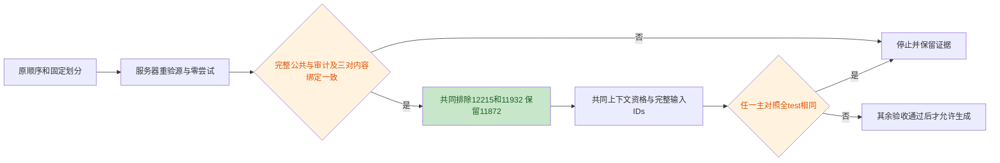
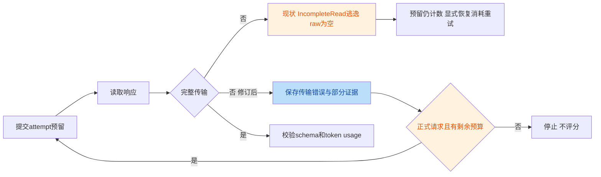

# 第2轮：统计/数据修订复审与代码交叉验证

日期：2026-10-24。评审基线：`b7990d15f6a1609646bf8a9792e230bd890441a1`。
代码范围：E2 相对 `e09fe84` 新增的执行器、适配器和相关测试；当前代码与基线一致。
科研范围：V4 基础合同及 V5-RC1，包括末尾主代理 R1 结论。

## 问题判定

两个代码候选均存在，均为 **P2**，没有将其中任何一项判为误报。
这里的问题编号 C1/C2 与协议的统计对比 C1/C2/C3 是两套编号。

| 编号 | 问题与严重度 | 最小修订建议（本轮不实施） | 新版本代码位置 |
|---|---|---|---|
| C1 | P2：不完整 HTTP 响应逃逸，中断传输证据落盘和自动计费重试；不是预算丢失 | 捕获 `IncompleteRead`，保存传输失败及可用部分字节证据，正式请求按原 payload/seed 和剩余预算重试；保留 probe 不重试、完整损坏成功响应拒绝 | [ledger.py:27-33](../../../src/memgate/experiments/ledger.py#L27-L33)，调用链 [217-219](../../../src/memgate/experiments/ledger.py#L217-L219) |
| C2 | P2：joint-change 不能排除 ON 与 ZE 全 test 相同，缺少必要主对照输入干预仍会安排生成 | 在最终共同合格 test 上逐一统计 ON/OO、ON/NN、ON/ZE 完整 IDs 的差异数；任一为零，在任何生成前停止，保留证据、不换题或快照 | [study.py:148-154](../../../src/memgate/experiments/study.py#L148-L154) |

候选报告把 C1 调用处写成 `ledger.py:209-212`；在本次基线中这几行是校验/构造结果，
真正的 reserve/request/save_raw 调用位置是 **217-219**。问题存在性不受该行号更正影响。

全部问题 JSON：

```json
[
  {
    "issue_id": "C1",
    "exists": true,
    "severity": "P2",
    "reasoning": "独立读取 Transport.request、Ledger.reserve/complete、CLI 异常处理及重试测试，并用无网络 HTTPResponse 字节流和内存 SQLite 复现：Content-Length=1000、实际11字节时 response.read() 抛出 IncompleteRead(11 bytes read, 989 more expected)，不在现有 except 元组内。一次调用后 attempts=1、retries=0、raw=NULL、results=0，未调用评分器。预留记录已提交，显式再次调用可按同一 payload/seed 消耗一次计费重试并成功，因此影响是自动恢复和传输证据缺失，不是预算丢失、免费重试或错误评分。P2，非误报；当前基线调用处应为 ledger.py:217-219。"
  },
  {
    "issue_id": "C2",
    "exists": true,
    "severity": "P2",
    "reasoning": "独立读取 source 的规则模式、pack_rules、七臂映射、官方 builder、prepare 门禁和 inference。旧规则首条合法但超长时按现有完整条目 packing 被全部删为空，新规则和经历仍变化，packed_rules 与 packed_experiences 同为 true，所以 study.py:148-154 放行。真实官方纯 builder 加 TinyTokenizer 的内存复现中 eligible=true，ON/OO 与 ON/NN 的完整 IDs 不同，但 ON/ZE 完全相同。旧规则打包独立于当前题，因此此构造可使全部合格 test 的 ON/ZE 相同，统计主 C3 无预定输入干预，仍支付整批生成成本。P2 属资源/验收缺陷，不是 Hoeffding 公式错误；没有证据断言真实服务器已经触发。"
  }
]
```

## 本轮结论

**统计/数据设计：PASS_FOR_FROZEN_PILOT。**
未发现需要再次修改 V5-RC1 的统计或数据设计阻断项。
该结论只针对其明确限定的单历史、固定题集、新解码 discovery，不是正式小效应确认或可投稿贡献验收。

**当前执行验收：未通过，不授权生成。**
C1/C2 尚未修复；V5 的复核消费入口、只读 auditor、身份绑定和新停止门禁尚待实现与工程验收。
本地没有服务器源日志/账本，不能确认服务器零尝试或真实上下文已合格。
上述缺口已被 V5 写为执行前硬条件，不能把设计通过当成条件已经满足。
仍须完成本轮第3轮工程评审，三轮通过后才允许编码。

中文简评：此次修订是在新 E2 输出之前，用公共输入解决明确的数据资格冲突，
同时阻止没有主对照输入干预的付费生成；没有改对照、阈值或追显著。
保守区间仍很宽，能放行的是冻结大效应/可行性 pilot，而不是可靠验证 3-6pp 收益。

## 证据与复核方式

意图：保留同一 E0 历史、原划分、七臂和六对比，把公共重复题资格判定做成可审计输入，
并在生成前排除无效主对照；不是重建记忆或扩大实验。

逐条读取了 `source.py`、`prompts.py`、`ledger.py`、`study.py`、`inference.py`、
`common.py`、`official.py`，以及官方 ExpeL builder/retrieval 和两个 E2 测试文件。
按 TRAE-code-review 对两个问题分别检查存在性、严重度和反例；
本会话无子代理调度工具，采用二次重读调用链及独立内存复现的 fallback。
本报告只代表这一位复核者，不宣称两位独立验证者已达成 2/2 共识。

本轮没有修改代码、协议、配置、README，没有提交或推送；
没有运行真实生成模型或 embedding 模型，没有启动任何服务器，也没有执行真实 `prepare/preflight/smoke`。
仅新增本评审文件。合成验证禁用了 Python bytecode 与 pytest 缓存。

审阅材料 SHA256：

```text
V4 docs/component_replay_protocol.md
f858562d595bb1e96d6f9b5f60538de43bb423da49e83d5883a4989e5137d0d8
V5-RC1 docs/component_replay_protocol_v5.md
51282a35aea3acc7f62624729cf290d107d4d2fec052a129bf23ebf7749cc919
候选报告 docs/reviews/e2_protocol_revision/candidates.md
56a8021fdcf9e677c659488c17477bdd7140b8dd9838ba97c0f2cbd4bda51e31
```

### C1：存在性和影响边界

`reserve()` 在事务退出时提交 attempt，之后才请求响应。
`IncompleteRead` 是 `http.client.HTTPException` 的子类，不属于目前捕获的
`URLError/socket.timeout/TimeoutError/ConnectionError`，也不被 CLI 的异常元组接住。
因此中断发生在 `save_raw()` 之前，原始失败无法按正常传输错误进入循环。

本轮以 `io.BytesIO` 提供合法 HTTP 头及11字节响应体，用真实 `HTTPResponse.read()` 触发异常，
patch 的只是 `urlopen`，不创建 socket 或 HTTP 服务。
内存 SQLite 复用了实际 reserve/complete 等方法，没有访问任何真实账本。

```text
首次调用：
IncompleteRead(11 bytes read, 989 more expected)
calls=1, logical=1, retries=0, attempts=1
raw=NULL, results=0, scorer_calls=0

显式再次调用，提供合成完整响应：
logical=1, retries=1, attempts=2, results=1
两次 payload/seed 完全一致
```

这验证的是内存中的显式恢复逻辑，不冒充真实进程崩溃后的磁盘恢复验收。
现有测试覆盖了429/500、返回传输错误、未知 attempt 的恢复和预算，但未覆盖 read 抛出
`IncompleteRead` 的路径。最小修复须保留每逻辑请求最多3次、全局44次重试和总2286次上限；
不能把截断字节当可评分答案，也不能为了重试而放宽完整成功响应的 schema/token 校验。

### C2：存在性和误报排除

[pack_rules:59-65](../../../src/memgate/experiments/prompts.py#L59-L65)
只保留完整前缀条目。首条超限时最终返回 `(empty)` 是合法 packing，并非新 bug。
ON 与 ZE 都使用同一 E新；当旧规则变成空块时，官方 scaffold 不附加臂名，
所以两个臂完整输入相同。组件不变性校验不会拒绝这种合法相同输入。

独立内存复现使用现有 `tiny_snapshots()`，仅将旧规则改为 `"1. " + "x"*2000`，
使用真实官方 AST 提取的纯 builder、TinyTokenizer 和固定二维检索向量：

```text
eligible=true
old_rules.text="(empty)", kept=0, total=1
packed_rules=true, packed_experiences=true
passes_current_joint_change_gate=true
ON/OO 不同，ON/NN 不同，ON/ZE 相同
ON=1098 tokens, ZE=1098 tokens，七臂均未超5888
```

不仅 token 数相等，完整 IDs 也逐项相等。
旧规则 packing 不依赖题目，故这不是只在某一题偶然发生的现象。
`study.py` 直到生成后报告才汇总相同臂比例，现有 preflight/smoke 也不会补上这个门禁。
但这不证明当前服务器的真实旧规则已经删空，TinyTokenizer 也不是 Qwen tokenizer 验收。

独立 seed 下相同输入仍可产生不同回答，不能据此声称观测差值一定为零或 CI 公式失效。
应停止的理由是预定主 C3 没有可识别输入干预，继续执行不服务于既定机制问题。

## 公共数据独立核对

只通过 `pd.read_parquet(..., columns=[...])` 读取以下四列：
`question_id/category/question/options`，再筛选 `category=="engineering"`。
没有调用会读取答案的 `source.load_public()`，没有读取或展示 parquet 的 answer/CoT 列。
原始文件另只做字节 SHA256。没有重新下载或访问服务器。

投影采用 `Official.public()`，qid 转字符串，题干和选项保持原文、选项原顺序；
JSON hash 均使用 `common.digest()` 的 UTF-8 canonical JSON，
即 `ensure_ascii=False, sort_keys=True, separators=(",", ":"), allow_nan=False`。
完整公共投影指源顺序下全部969道 Engineering 题，不是只对六个候选端点或 test 求 hash。

```text
原始 parquet SHA256
0e24a191921c2f453518a537a8b2117bd137e7714d4ef1565e9ba06c1ecb9ad8
有序完整公共投影 digest(public)
478bd4297ac233c672dfc934cb1ab2c1c01c1d3740005c10222c270ae6852e20
原算法完整候选审计 digest(audit)
fa0a1f1d11e97a702a3a78620d88a261b7778fb4e6cc350211560f41a797d7fe
```

三者与候选报告一致。审计 hash 是原算法返回的完整 audit 对象的摘要，
不是带 seal 外壳或尾部换行的文件字节 hash；未来 auditor 必须明确区分。
复算边界为 old=193、new=581，固定 dev64/test96，跨边界比较99,104次，候选恰好三对；
全部 `exact=false`、`status=unresolved`、`same_unordered_options=false`，
原始审计仍为 `qualified=false`。

| prefix / test | 题干相似度 | 独立语义判定 | 唯一处理 |
|---|---:|---|---|
| 11528 / 12215 | 0.9458128078817734 | 同一铜板吸收功率题；1000 Mc/sec 与1 GHz相同，峰值电场、介质、入射方式和求解量相同；选项表达/内容变化不消除题干重合 | 七臂共同排除 test 12215 |
| 11568 / 11872 | 0.925 | 拉普拉斯输入分别为 `1/[s(s^2+1)]` 与 `1/(s-1)^2`，公式确实不同；相同问句模板不能证明同题 | 保留 test 11872 |
| 11804 / 11932 | 0.9921875 | directivity=50、波长4m、求最大有效孔径，条件与求解量相同；空格及选项变化不消除同题关系 | 七臂共同排除 test 11932 |

完整读取了每对两端的公共题干及全部选项后才给出以上结论，没有使用正确选项或推导答案。
各端公共内容摘要如下，明确采用 `digest({"question": 原题干, "options": 原顺序完整选项})`；
阶段/qid 单独绑定，不能单靠 qid 应用判定：

| 阶段 | qid | 公共内容 SHA256 |
|---|---|---|
| prefix | 11528 | `feb304b3c6847f25fcdde62d4594cff7ccaa63e99893fa8bffed957c4af479c4` |
| test | 12215 | `cb763e97665118f687b3b4d6f37621df92e9f759c6f6f6e10efe2864f7b2fab1` |
| prefix | 11568 | `931de65db1e18f4779daff3331baea0f5bb98762b7f33cb6b0b721d37fd25208` |
| test | 11872 | `741a3cd0cbff4fea3c5518524ac87a56f439816ce773dcfe207e87e5d620facb` |
| prefix | 11804 | `fcb8be8b0ae09574890eb175bad38fb7eb08f8a1cbef2c396169a0c0397f138f` |
| test | 11932 | `20f59901df96747ffd990ac157d918dfc6e081aa9cbfdb0e994f86898307249a` |

[V5:32-46](../../component_replay_protocol_v5.md#L32-L46)
要求同时绑定完整公共投影、完整原审计及每对两端内容，并拒绝缺项、多项、重复、未决或不匹配。
这是充分明确的冻结要求；上述 hash 是本地复核证据，不是已经存在的服务器资格产物，
也没有创建计划中的 `configs/e2_duplicate_review.json`。
三对候选不是语义查重的完备证明，更不能据此断言真实检索已利用泄漏答案。

## 统计审查

### 资格、选择与推断目标

[V5:48-79](../../component_replay_protocol_v5.md#L48-L79)
仅删除两个已确认重复的 test 端，保留前缀记忆和原 dev 列表，不补位、不改变 seed 或快照。
原 test 顺序中排除项为11932、12215；11872仍保留。数据资格阶段剩94题，
之后仍可能被七臂共同上下文规则排除，故最终只能写 **n<=94**。
应分别报告原始96、重复排除2、上下文排除和最终 n，所有臂共用分母。
原 dev64 列表不受本次重复修订影响，但仍适用 V4 的共同上下文资格检查。

公共输入资格及全 test 主对照退化检查均在新输出之前确定，
条件于最终固定合格题集进行推断，不构成按新回答筛题。
这不恢复“未见测试题”的资格：E0 结果已查看，单历史限制不变。
新 auditor 必须证明零 attempts/零 results，才能把“生成前修订”从交接声明变成运行证据。

新的全同门禁逐一检查 ON/OO、ON/NN、ON/ZE；任一差异数为零则
`DEGENERATE_MAIN_CONTROL`，停止而非换题、换快照或换主对比。
部分题相同仍留在同一分母并独立生成两次，不能只分析发生变化的题来提高效应。
该门禁只排除完全退化，不保证剩余干预强度或功效，V5 没有作这种保证。

### 六对比与区间

[inference.py:59-111](../../../src/memgate/experiments/inference.py#L59-L111)
与 [V4:128-188](../../component_replay_protocol.md#L128-L188)
一致：C1=ON-OO、C2=ON-NN、C3=ON-ZE、I=NN-NO-ON+OO、D_F=S-F、D_ON=S-ON。
条件于历史、固定题集、dev及封存 S/F，只对新解码均值推断。
每个有界独立请求权重为 `c_a/(2n)`，平方权重和为 `sum(c_a^2)/(2n)`，
故每个双侧区间取
`h=sqrt(sum(c_a^2)*log(240)/(4n))`，失败概率至多0.05/6；
对六区间用 union bound 得同时覆盖率至少95%，不要求对比之间独立。

相同所选臂先合并系数，零系数差值及区间精确为零；
这与“两个不同臂输入恰好相同但独立生成”不同，后者不能直接合并观测。
`Vhat_dec=sum(c_a^2*(Y1-Y2)^2)/(4n^2)` 在稳定、独立同分布的同单元两次解码下是无偏的；
题间差值方差不替代主区间。hash seed 和打散顺序不是独立性或后端稳定性的证明。
dev 的预算授权、固定平局顺序和先封存选择后 test 保持不变，
因此 D_F/D_ON 仍只评价这次固定选择，不能推广为选择算法平均收益。

### 功效与预算

| n | 普通差值半宽 | 单项下界严格超过3pp所需观测差值 |
|---:|---:|---:|
| 96 | 16.89526395pp | >19.89526395pp |
| 94 | 17.07405479pp | >20.07405479pp |

独立数值复算与 V5 一致，半宽仅增加0.17879084pp；更小 n 会继续加宽。
主 GO 要求三个必要对比全部达标，不能把单项功效当成联合 GO 功效。
低功效来自原设计，不能作为公式 bug，也不能用点估计为正声称方法成立。
若目标改为可靠确认3-6pp收益，本协议应判不适用，需另行预注册语义组隔离、
多历史/多任务和充分功效的确认设计，而非在本轮追加题目或重复。

无上下文排除时逻辑请求为 `(64+94)*7*2=2212`，smoke 包含在 dev 中。
2240逻辑请求上限、2探测、44全局重试、2286总上限和每请求最多3次不变；
28个省下的逻辑请求不能转为增样或额外重试。实际请求集合由封存 manifest 决定。
输入5888、输出2048、余量256、总窗口8192亦不变。

## 交给第3轮的执行前验收

以下是 V5 已规定但尚未完成的条件，不是本轮已经验收的结果：

1. 新 `audit-data` 不加载模型、不请求服务；在服务器重算同一公共投影、原候选审计、
   三对绑定，校验完整源日志 ID/顺序/公共字段及前缀记忆链，不把本地公开 parquet 当服务器源。
2. 只读打开既有 `runs/.e2-ledgers/component-v4.sqlite`，核实 attempts/results 均为零，
   包括 probe、unknown dispatch 和失败预留；文件缺失或不可读不能直接宣称“零尝试”。
   迁移不能删除账本、重置计数或另建预算槽。任何非零尝试都阻止沿用本次生成前修订迁移。
3. 修订记录、V5协议、代码和资格结果进入 manifest/fingerprint；保留 V4 原审计的
   `qualified=false`，不得复用旧 manifest 来绕过完整绑定。审计必须先于模型文件大规模 hash、
   embedding 和打包，不能仅在最终生成入口检查。
4. 实现并回归 C1：截断响应证据、原 payload/seed 计费恢复、probe不重试、各预算上限，
   以及完整损坏成功响应、400、token usage不符继续拒绝。不要将传输故障作为答错。
5. 实现并回归 C2：三个主对照分别全同的负例均在任何生成前停止；
   旧规则删空的实际 builder 例必须纳入；部分相同题保留，正常非退化例不误杀。
6. 完成三轮及实施验收后，服务器步骤才可依次为只读审计、prepare、preflight、
   正式dev smoke、完整dev、封存selection、test和分析。版本README、发布/推送及
   Git bundle 操作由主代理后续处理，本报告不假设 `audit-data` 已可调用，也不启动任何步骤。

当前无须再改 V5-RC1 的科学条款；若以上证据不一致、候选集合改变或零尝试前提不成立，
执行判 **FAIL**，先解决绑定/来源/迁移问题并重审，不通过改变题目、阈值或账本强行放行。

## 流程摘要

数据与干预资格：



C1 现状与最小恢复合同：



## 实际验证记录

- C1 无服务器 HTTPResponse + 内存 SQLite：复现异常逃逸，并验证再次调用按同一 payload/seed 计费恢复。
- C2 官方纯 builder + TinyTokenizer + 合成快照：复现合法共同变化但 ON/ZE 全 IDs 相同。
- 公共 parquet 四列投影：重算969题顺序、193/581边界、64/96划分、99,104次比较、
  三对候选、三个整体 hash 和六端内容 hash；核实仅排除两道 test 后数据资格数94。
- 9项定向纯离线测试：**9 passed in 2.07s**。覆盖官方检索/builder与公共投影、
  重复审计、完整条目packing、共同上下文排除、评分/零系数、方差/严格阈值、
  纯函数服务身份/usage校验以及选择授权。没有选用会启动 `fake_http` 服务的测试。
- 没有重跑候选报告所述46项全量测试；不把这9项或合成复现当作真实模型、
  真实 tokenizer、服务器源完整性、磁盘账本或零尝试验收。
